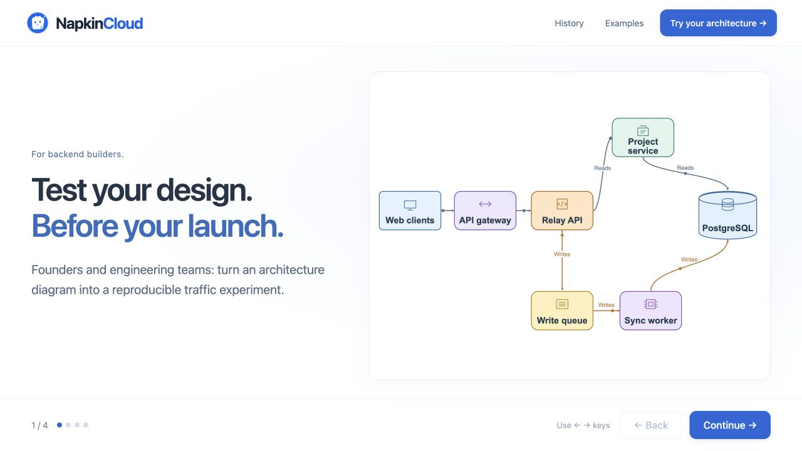
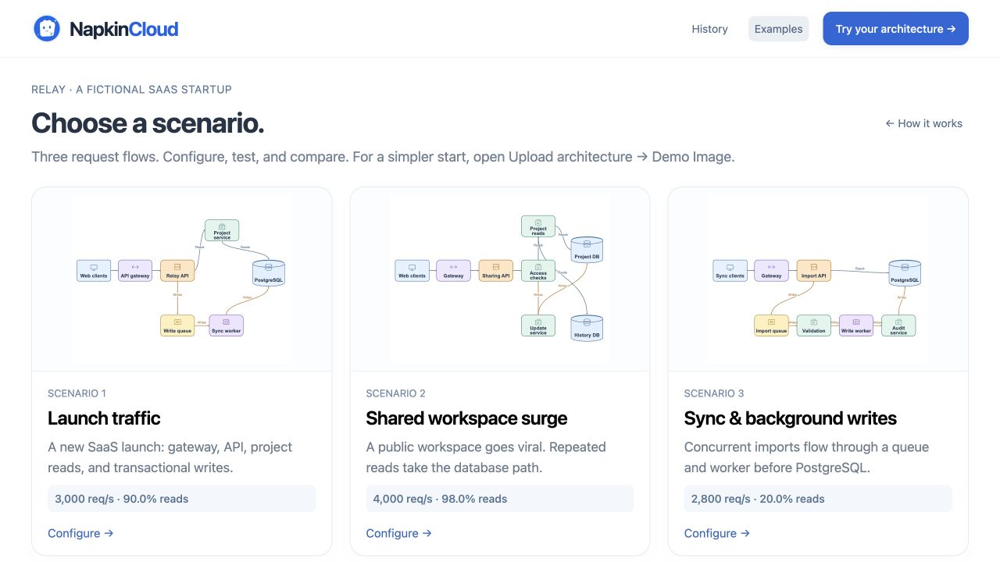
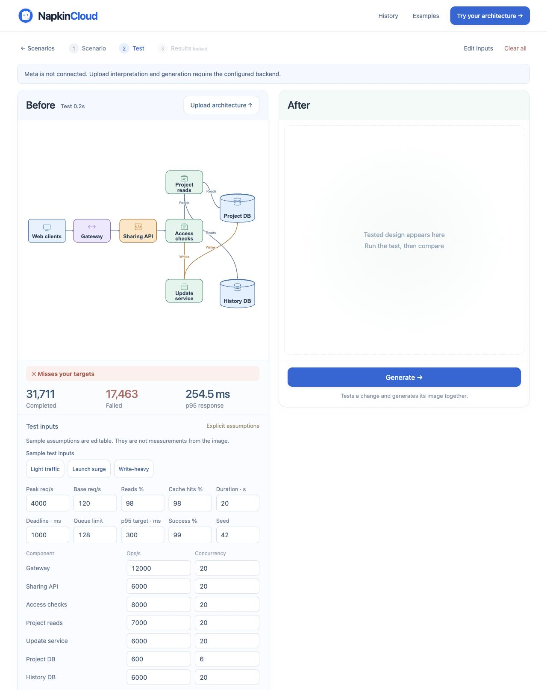
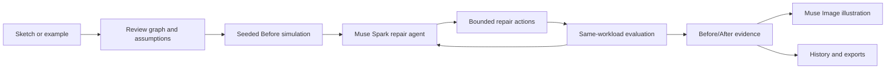

# NapkinCloud

## ▶ Watch the demo

<a href="https://youtu.be/WKyKA6PkrjU?si=b4RXW4s0yE1fwBxE">
  
</a>

**[▶ Watch the full demo on YouTube](https://youtu.be/WKyKA6PkrjU?si=b4RXW4s0yE1fwBxE)**

**Sketch. Test. Improve.** A Meta-powered architecture workbench for founders and backend teams. Turn a system diagram into a reproducible traffic experiment, identify its bottleneck, and compare a tested repair against the original.

[](https://github.com/shubhranshu-p/napkincloud/actions/workflows/ci.yml)

[How it works](docs/ARCHITECTURE.md) · [Run locally](#run-in-two-minutes) · [Publish on GitHub Pages](docs/GITHUB-PAGES.md) · [Three-minute demo guide](docs/DEMO-VIDEO.md)

[MIT License](LICENSE)

## Project screenshots

**Architecture workbench** — start with a sketch or a built-in scenario.



**Built-in scenarios** — launch traffic, shared workspaces, and background writes.



<details>
<summary>View the traffic-testing workspace</summary>

A local simulation of the shared-workspace surge, showing the original architecture, failed requests, latency, and editable assumptions. Meta is unconfigured in this capture; the After panel awaits generation.



</details>

A live website requires a running backend; GitHub Pages by itself cannot execute secret-backed model calls.

## About

### What is NapkinCloud?

NapkinCloud takes a backend architecture — drawn on a napkin, uploaded as an image, or picked from a built-in example — and answers one question with evidence: **will this design survive its traffic?**

You describe the traffic (a launch surge, heavy reads, queued background writes), run a **Before** simulation to expose failures and bottlenecks, then let Meta propose a repair. Every candidate repair is executed against the **same frozen workload and seed**, so the Before/After comparison is fair and reproducible. The result is presented as an animated verified flow, a generated architecture illustration, colored findings, numerical comparisons, stress cases, and a written explanation.

Failure is a valid result: insufficient repairs keep their evidence visible instead of being hidden. Generated artwork is explanatory only — executable graphs and numerical evidence determine the result.

### Who is it for?

- **Founders** who want to sanity-check a backend sketch before building it.
- **Backend teams** who want a quick, reproducible way to compare "add a cache" vs "scale the API" vs "partition the database" for a given workload.
- **Reviewers and judges** who need independently recomputed evidence (exports), not screenshots of prose.

### How it works

1. **Choose a scenario or upload a diagram.** Uploaded images go through Meta vision interpretation, then human connection review — you confirm the extracted components and connections before anything runs.
2. **Configure traffic and assumptions.** Pick Light traffic, Launch surge, or Write-heavy sample inputs (or type a scenario in plain English), then edit traffic, targets, capacities, queues, and deadlines. Inputs stay visible before and after uploading.
3. **Run the Before test.** The seeded simulator executes the workload and exposes failures, bottlenecks, p95 latency, and success rate.
4. **Generate the After.** You explicitly press Generate — nothing runs automatically when you select an example. Muse Spark reasons over bounded architecture changes and invokes tools to evaluate candidates against the frozen inputs.
5. **The simulator judges.** Each candidate passes or fails on the configured targets. Failed attempts remain visible. A separately labeled bounded verification search may test extra partition counts after insufficient model candidates — it is never misrepresented as model reasoning.
6. **Review both designs.** The app shows the animated verified flow, a Muse Image illustration of the tested design, findings, stress cases, and a three-part explanation (cause, measured change, remaining limitations).
7. **Export or revisit.** Download recomputed evidence bundles, or reopen a saved run from browser-local History. Restoring a run makes no Meta calls.

### Meta models used

| Model | ID | What it does in NapkinCloud |
|---|---|---|
| **Muse Spark 1.3** | `muse-spark-1.3` | Interprets uploaded diagrams (vision, low reasoning effort); converts plain-English traffic descriptions into parameters (minimal effort); proposes tool-backed architecture repairs as an experiment agent (high reasoning effort, up to 3 candidates over 5 turns). |
| **Muse Image 1.0** | `muse-image-1.0` | Illustrates the tested After architecture from the exact executable graph. Explanatory only — never affects metrics. |

Supporting rules from the implementation (`src/meta.mjs`):

- All reasoning calls go to `https://api.meta.ai/v1/chat/completions`; image calls go to `https://api.meta.ai/v1/responses`. The API key (`MODEL_API_KEY`) stays on the server and is never shipped to the browser.
- The agent calls `evaluate_architecture` to test three allowed change types: `add_cache` (Redis for eligible reads, never writes), `scale_api` (2–4 replicas), and `partition_database` (2–8 total independent tenant stores, unchanged per-store capacity). Workload, seed, targets, and service assumptions are protected inputs the model cannot change.
- `finish_evaluation` can select only an evaluated candidate that meets the configured targets, or return no passing repair.
- A deterministic seeded simulator evaluates every candidate; prose and images never set the metrics.
- These are the model IDs configured in this source release. `META_PARSE_MODEL` can override the vision/scenario model; repair and illustration models are fixed server-side. Live access depends on the configured Meta account and is separate from the mocked test suite.

## Run in two minutes

Install **Node.js 24 or newer**, download or clone this repository, then run:

```sh
npm start
```

Open **http://localhost:8787**. The tour, three Relay SaaS examples, four demo images, and traffic simulation work without an account or API key. No application dependencies need installing.

For architecture uploads, repair generation, and illustrations:

```sh
cp .env.example .env
# Add your Meta Model API key to MODEL_API_KEY in .env.
npm start
```

The key stays on the server. The GitHub Pages frontend requires the full backend described in [Pages setup](docs/GITHUB-PAGES.md). A public clone does not contain the author's credentials. For judges, use the submitted **hosted demo URL** to access the author's configured backend. See [deployment and judging](docs/DEPLOYMENT.md).

## Try the project

1. Follow the short tour or select **Try your architecture → Upload architecture**. The **Demo Image** library includes a simple starter and three examples. Upload a demo through Meta, download its PNG, or choose your own image.
2. Choose one of three fictional Relay SaaS cases: a launch surge, shared workspace reads, or queued background writes.
3. Review uploaded connections and assumptions. Choose **Light traffic**, **Launch surge**, or **Write-heavy** sample test inputs, then edit traffic, targets, capacities, queues, and deadlines.
4. **Run test**, then **Generate After**. Both designs use the same workload and seed. No results are generated automatically when selecting an example.
5. Inspect the animated verified flow, generated illustration, colored findings, numerical comparison, stress cases, and explanation.
6. Download recomputed evidence or reopen a saved run from browser-local History.

Provider errors have explicit retries; billable operations never automatically retry.

## Technology stack

- Vanilla JavaScript, HTML, and CSS for the interface; no application framework or runtime packages.
- Node.js 24+ for local serving and compilation; an ESM Worker for optional hosted execution.
- Meta Model API for vision, reasoning, tool calls, and image generation.
- A custom seeded, finite-queue simulator for reproducible traffic experiments.
- Original SVG diagrams for the executable flow; IndexedDB for browser-local saved runs.
- GitHub Actions for syntax checks, regression tests, builds, and the optional Pages frontend.

## How it is built

NapkinCloud is a custom JavaScript application with a shared execution core for local Node.js and Cloudflare Workers. Its implementation has five connected layers:

1. **Architecture as executable data.** [`src/model.mjs`](src/model.mjs) validates component types, connections, routing, service assumptions, and workload bounds. Uploaded sketches become editable graphs before execution; capacities are explicit assumptions rather than measurements inferred from a drawing.
2. **Reproducible experiments.** [`src/simulator.mjs`](src/simulator.mjs) runs seeded traffic through finite-capacity services and queues. The original and repaired graphs use the same workload and seed, so reported improvements come from a tested architecture change.
3. **Meta as the experiment agent.** [`src/meta.mjs`](src/meta.mjs) sends diagrams and scenarios to Muse Spark, exposes bounded repair actions through tool calling, feeds simulator results back to the model, and requests a Muse Image illustration of the selected graph. Graph validation and tool results constrain the model's choices.
4. **A browser workbench.** [`src/app.js`](src/app.js), [`src/diagram.mjs`](src/diagram.mjs), and [`src/history.mjs`](src/history.mjs) connect input review, traffic controls, streamed experiment progress, animated SVG diagrams, and browser-local history. [`src/export.mjs`](src/export.mjs) recomputes evidence for download.
5. **One backend, two run targets.** [`src/handler.mjs`](src/handler.mjs) implements the API; [`scripts/dev.mjs`](scripts/dev.mjs) serves it locally, and [`scripts/compile.mjs`](scripts/compile.mjs) bundles the Worker. GitHub Actions runs the syntax checks, regression tests, and both build targets.



The included [architecture notes](docs/ARCHITECTURE.md) explain the execution model, and [design sources](DESIGN-SOURCES.md) record the visual references and asset provenance.

## Project layout

```text
src/                   Browser, API, simulator, validation, Meta adapter, exports
scripts/               Local server, compiler, checks, artifact/release preparation
test/                  Deterministic and mocked-provider regression tests
docs/                  Architecture, deployment, and judging instructions
assets/                Bundled assets with provenance and license records
Demo Image/            Four uploadable PNGs, original SVGs, and matching JSON inputs
.github/workflows/     Automated checks on pushes and pull requests
.env.example           Empty server configuration template
wrangler.jsonc         Standalone Worker deployment configuration
```

Build output (`worker/`, `dist/`), local credentials, browser history, recordings, `pages/`, and development caches are ignored. The clean release contains no private hosting identity or prior Git history.

## Checks and build

```sh
npm run check
npm test
npm run build
npm run build:pages
```

Tests do not require a Meta key and use mocked transport for paid paths. `npm run build` emits a self-contained Worker ESM and validates its entrypoint. `npm run build:pages` produces a GitHub Pages frontend in `pages/`. The included workflow deploys it after you upload the repo and enable Pages. See [Pages setup and required backend](docs/GITHUB-PAGES.md). `npm run release` prepares a separate clean source folder in `releases/napkincloud` without credentials or history.

## Scope and limitations

The simulator uses seeded arrivals, synthetic service durations, finite queues, explicit deadlines, and conditional read/write paths. Extended graphs support 3–16 components and up to 40 connections. Queues and workers are awaited; alternative routing is supported; parallel fan-out and joins are not. Combined cycles are rejected. Redis caches eligible reads, never writes.

Comparisons freeze traffic, seed, duration, targets, and per-component assumptions. Tenant partitioning adds independent stores with unchanged per-store capacity; zero skew routes across all stores. Hot-tenant concentration, cold caches, and write-heavy traffic can still fail. Migration, cross-partition transaction correctness, durability, and production network behavior are outside this simulation. Percentiles cover successful requests; failures remain separate.

**Results are simulated, not production benchmarks.** Extended graphs export evidence and graph files, not a deployable application. The legacy reference stack is included only where its supported topology applies. Docker execution has not been verified as part of this release.

## Credentials and availability

Keys are configured through server environment variables or the host's encrypted secret manager, never browser JavaScript. Browser history stays in that browser; exports contain no credentials. Hosting must remain online, and the Meta account must retain model access, valid credits, and an unexpired key throughout judging. Optional `META_ACCESS_UNTIL` disables paid operations after a server-controlled timestamp.

The per-process rate limiter reduces accidental calls but is not a global dollar spending cap. See [security](SECURITY.md) and [deployment](docs/DEPLOYMENT.md) before exposing a paid backend publicly.

[Architecture](docs/ARCHITECTURE.md) · [Development](CONTRIBUTING.md) · [Design sources](DESIGN-SOURCES.md) · [MIT license](LICENSE)
