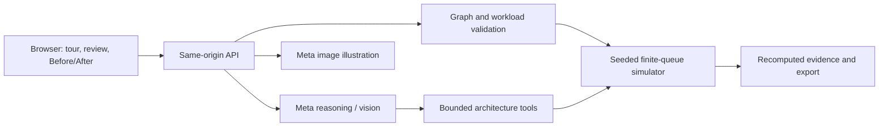

# Architecture

`src/app.js`, `index.html`, `style.css`, and `history.mjs` implement the browser. `model.mjs`, `simulator.mjs`, and `diagram.mjs` define validation, execution, and the verified SVG. `meta.mjs` coordinates Meta calls and bounded repair tools. `handler.mjs` exposes the same routes in the Node server and the compiled Worker. `diagnostics.mjs` derives explanations from actual evidence. `export.mjs` independently recomputes exports. `examples.mjs` supplies three fictional Relay SaaS scenarios.

A comparison freezes the original workload, seed, duration, targets, and per-component assumptions. Repairs may add a read cache, API replicas, or independent tenant database partitions. Additional resources are explicit. At zero tenant skew, keys hash across every partition. A nonzero skew is the share of tenant keys routed to the first store; the remainder is distributed across other stores.

Conditional paths model alternative routing, not parallel fan-out. Workers and queues are awaited. A cycle in the combined graph is rejected even if each request type might individually form an acyclic path. Retry semantics, durability, joins, migration correctness, and cross-partition atomicity are not modeled. Percentiles cover successful requests; rejections/timeouts are separate.

Generated images are explanatory and may differ from the graph. The executable graph, animated SVG, and recomputed evidence determine the result. These are synthetic simulations, not production measurements.
